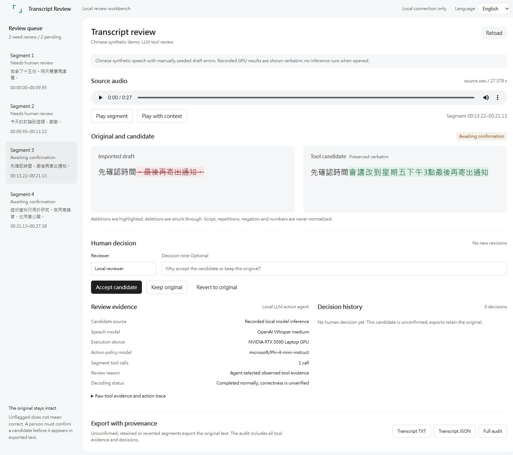
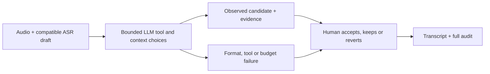

# Transcript Review Agent

**Review a transcript against its source audio, with tool evidence and reversible human decisions.**

English | [繁體中文](README.zh-Hant.md)

A local workbench that follows Whisper or another compatible ASR draft. A bounded LLM policy chooses tools and context; speech tools provide candidates; a person accepts, keeps or reverts each change. The imported draft, model output and decision history remain traceable.



## Try it — no GPU required

With **Python 3.11 or newer**:

```powershell
git clone https://github.com/momonong/transcript-review-agent.git
cd transcript-review-agent
python app.py
```

Open [http://127.0.0.1:8765/](http://127.0.0.1:8765/) on the same computer. No package installation is needed for this demo.

Listen to four Chinese synthetic segments, compare the draft with recorded candidates, inspect raw evidence and action traces, make reversible decisions, and download TXT, JSON or the full audit. **Opening the demo reads an existing GPU result; it does not run inference or download models.**

The interface starts in English. Select **繁體中文** to switch; an explicit choice is remembered when browser storage is available. Changing the interface language leaves source text, candidates, reviewer names and notes unchanged.

## What the recorded run actually shows

One local GPU run used **Microsoft Phi-4-mini-instruct** to select tools and context, with **OpenAI Whisper medium** for speech recognition. The source contains **4 Chinese synthetic segments, 27.3775 seconds**, with manually seeded draft errors and a control segment. It recorded **8 LLM decisions and 4 speech-tool calls**.

| Segments | Observed outcome | Evidence retained |
|---|---|---|
| Repetition, correction and numbers; control | 2 human handoffs | Phi returned Markdown-fenced JSON; the strict parser rejected it |
| Omitted utterance; negation | 2 pending candidates | Observed speech-tool evidence, original wording and action trace |

**Two pending candidates and two handoffs are routing outcomes, not accuracy or effort-saving rates.** A fixed-process run on the same source is also available; this does not establish an advantage for the agent.

The omitted-utterance example preserves these actual strings:

| Imported draft, with a seeded omission | Model candidate, verbatim |
|---|---|
| 先確認時間。最後再寄出通知。 | 先確認時間會議改到星期五下午3點最後再寄出通知 |

For English readers: the omitted sentence concerns a meeting moved to Friday at 3 p.m. This explanation is an English gloss, **not ASR output**. The demo remains Chinese; script, punctuation, repetitions, negation and numbers are not normalized.

All demo speech is author-written fiction synthesized with Windows SAPI, with no patient data. Reading scripts are synthetic source material, not independent human ground truth.

[Actual LLM and tool trace](docs/results/chinese-agent-result.json) · [Fixed-process record](docs/results/chinese-baseline-result.json) · [Validation evidence](docs/validation.md)

## From evidence to a human decision



The LLM can select an observed tool hypothesis; it cannot accept changes for the reviewer. Unconfirmed, retained and reverted segments export the imported text. Unflagged does not mean correct. Each decision creates a new revision without overwriting the source audio or original review.

## Implemented and still unverified

| Area | Current scope |
|---|---|
| English / Traditional Chinese workbench | Audio and context playback, text diff, evidence and trace, accept / keep / revert, export |
| Review policies | Fixed process and bounded Phi action agent, with an explicitly configured local Whisper tool |
| Portable demo | Recorded GPU results, usable without a GPU; real Chinese synthetic audio |
| Optional live review | Starts only after local models are configured and the reviewer presses **Run review** |
| UGen300 USB | Proposed architecture; not tested |
| Quality and time benefits | Matched final-quality, human-effort and end-to-end comparisons remain to be done |

Local execution does not establish institutional approval for medical use. The tool does not diagnose or score clinical scales.

## Use your own review

```powershell
python app.py --review your-review.json
```

The server listens only on `127.0.0.1`. New revisions go to `.local/workbench/revisions` by default; use `--save-dir` to choose another location, or `--port 8767` if needed. Source-content changes, failed integrity checks and revision conflicts block playback or changes rather than silently changing the evidence.

The downloaded full audit includes local source locators. Review it before sharing.

For live GPU review, pinned dependencies, local model weights, input requirements and CLI examples, see the [English runtime guide](docs/runtime.en.md) or [繁體中文執行指南](docs/runtime.zh-Hant.md). Adapters use explicit local weights, with no automatic model download or CPU fallback. The speech tool currently requires mono, 16 kHz, PCM16 WAV, with a maximum 30-second interval per call.

## Development checks

The core uses the Python standard library. Run from the repository root:

```powershell
$env:PYTHONPATH = "$PWD/src"
python -B -m unittest discover -s tests -v
node tests/test_workbench_js.mjs
```

The Python suite covers import and source integrity, bounded model/tool actions, reversible decisions, HTTP boundaries and failed-job preservation. The JavaScript regressions cover polling recovery and bilingual presentation, including preserved edits and playback, raw text fidelity, and unavailable browser storage. Engineering checks are separate from human acceptance of transcript quality.

## Documentation

- [Product concept and proposed evaluation](docs/concept.md) — English
- [Runtime, model provenance and CLI examples](docs/runtime.en.md) — English
- [Validation and recorded engineering observations](docs/validation.md) — English
- [Initial CLI implementation plan](docs/prototype-plan.md) — English
- [本地工作台計畫](docs/interactive-prototype-plan.zh-Hant.md) — 繁體中文
- [本機環境與模型來源](docs/runtime.zh-Hant.md) — 繁體中文

Historical proposal drafts stay local and retain their design-stage status. Public source contains no protected external project assets, patient data or private recordings.
