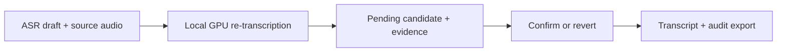

# Transcript Review Agent

**An agent for the first review pass, downstream of compatible ASR drafts.**

Turn source audio and existing Whisper or task-specific ASR output into evidence-linked transcript revisions, reversible decisions, and usable review data.

**Current milestone:** a runnable fixed-policy prototype with real local GPU re-transcription and reversible decisions.

## Initial result

A **9.722-second fictional English recording**, synthesized with Windows SAPI, was checked with **Whisper medium on an RTX 5090 Laptop GPU**. The initial draft below contains **manually seeded errors**, rather than naturally occurring ASR errors.

| Stage | Text | Evidence |
|---|---|---|
| Seeded input | `I took fifteen. We need more tomorrow.` | Manually introduced draft errors |
| Real GPU candidate | `I, I did not take 15. I took 50. No, 51. We do not need more tomorrow.` | Actual local CUDA inference, offered as **pending** |
| Scripted revert export | `I took fifteen. We need more tomorrow.` | Accept/revert path restored the original |

In this case, the model output retained repetition, negation, and the spoken numbers. **20 tests pass**, including original preservation, decision consistency, source-path boundaries, and incomplete-generation handling.

[Public result excerpt](docs/results/initial-gpu-result.json) · [Validation details and timestamps](docs/validation.md)



The evidence has three levels: **fictional fixtures** exercise the review workflow, **real GPU inference** verifies the local model integration, and **human quality or effort benefits remain unmeasured**. The decisions above were scripted, not independent user quality acceptance. All demonstration content is synthetic and fictional, with no patient material.

## Current status

| Area | Status |
|---|---|
| Import, bounded checks, GPU tool, decisions, audit export | Working initial prototype |
| Action selection | Fixed-policy baseline; LLM agent policy not implemented |
| UGen300 USB | Candidate architecture, not tested |
| Quality, human effort, end-to-end benefits | Evaluation planned, no efficacy claim |

The target is less human review work at the same final quality. Medical research is the first proposed validation setting; interviews and other research recordings are compatible-input candidates requiring their own validation. See the [concept](docs/concept.md) and [prototype plan](docs/prototype-plan.md).

## Run the local prototype

Python 3.11+ is required. The core uses only the standard library.

<details>
<summary>Core quickstart: fictional fixture, review, accept, revert, export</summary>

From the repository root in PowerShell:

```powershell
$env:PYTHONPATH = "$PWD/src"
python -B examples/make_fictional_fixture.py --out .local/fictional
python -B -m transcript_review_agent review .local/fictional/input.json --fixture .local/fictional/evidence.json --out .local/review.json --budget 3
python -B -m transcript_review_agent decide .local/review.json s1 accept --reviewer demo --out .local/accepted.json
python -B -m transcript_review_agent decide .local/accepted.json s1 revert --reviewer demo --out .local/reverted.json
python -B -m transcript_review_agent export .local/reverted.json --out-dir .local/export
python -B -m unittest discover -s tests -v
```

This fixture creates silent synthetic WAV audio and explicitly fictional evidence. It tests the review and audit workflow, not speech recognition. For another run, use new output paths: commands refuse to overwrite existing files. Pending, rejected and reverted items retain original text. The export includes `transcript.json`, `transcript.txt`, and the full `audit.json`.

</details>

<details>
<summary>Optional real GPU re-transcription with an existing local checkpoint</summary>

Use a Python interpreter from a separately verified torch/transformers CUDA environment. Pass an existing Transformers Whisper checkpoint directory explicitly:

```powershell
$env:PYTHONPATH = "$PWD/src"
python -B -m transcript_review_agent review path/to/input.json --whisper-model path/to/local/whisper-checkpoint --language en --device cuda:0 --out .local/gpu-review.json --budget 2 --context 1.5
```

The adapter uses `local_files_only=True`, float16, and an explicit language/task. It requires CUDA and never downloads a model or falls back to CPU. The tested host checkpoint is Whisper medium; this does not validate Whisper Small on USB. Runtime packages and weights are not bundled. The dependency-free core lock does not reproduce the optional GPU environment.

The current adapter accepts mono 16 kHz PCM16 WAV, verifies declared duration against WAV frames, and rejects clips above 30 seconds. Other media require explicit conversion. A tool action decodes the target and, when needed, its wider context, with at most two model generations. Only the target hypothesis becomes a pending candidate; context remains separate evidence. Target/context decoding must end with genuine EOS before a candidate is offered. Missing EOS requires human review, while EOS itself does not prove accuracy.

</details>

<details>
<summary>Input contract, preservation, and limitations</summary>

Input JSON requires a relative `source.path`, `source.duration` in seconds, and unique segments with `id`, `start`, `end`, and `text`. Preserve speaker metadata when available. Missing timestamps require an explicit alignment adapter. Defaults are 2 MiB JSON, 512 MiB media, and 24 hours of declared source duration. See the versioned fictional manifests in `examples/`.

Timeline gaps and overlaps are cues, not error verdicts. Overlaps can be legitimate simultaneous speech. Unflagged text is never labelled correct. Tool failure or budget exhaustion returns work to human review.

Review/audit files preserve the original and contain an explicit local source locator for cross-directory use. Keep them in ignored `.local/` or another private location. Schema checks, hashes and decision-history replay reject inconsistent records; they are not digital signatures. Early development review files missing these fields must be regenerated rather than silently repaired.

No LLM action policy, reviewer UI, broader media conversion, missing-timestamp alignment, or USB adapter is implemented. No clinical diagnosis, assessment scoring, measured labor saving, or institutional approval is claimed.

</details>

## Project documents

- [Concept and intended evaluation](docs/concept.md)
- [Prototype implementation plan](docs/prototype-plan.md)
- [Validation and engineering timestamps](docs/validation.md)
- [Whitelisted initial GPU result](docs/results/initial-gpu-result.json)

Local historical proposal drafts remain preserved and are not included in the prototype source publication. They describe the design-stage status when prepared. The new prototype contains no NeuroAI code, patient data, or private recordings.