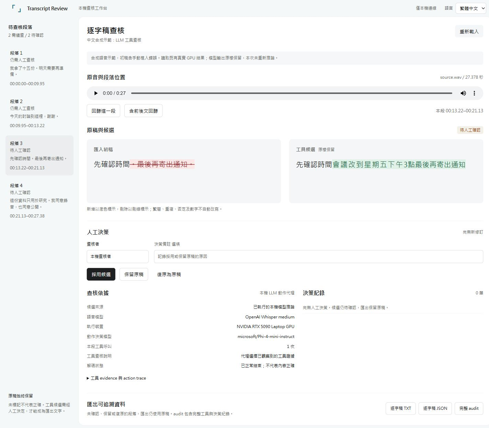
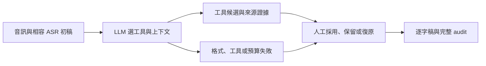

# Transcript Review Agent

**讓 agent 先查一輪逐字稿，再由人依原音確認。**

[English](README.md) | 繁體中文

從醫療研究影音需求出發，接在 Whisper 或其他符合匯入契約的 ASR 初稿之後。保留原音、匯入初稿、候選差異與可復原的決策，整理成可追溯的逐字資料。



## 三步開啟，不需要 GPU

需要 Python 3.11 以上。在終端執行：

```powershell
git clone https://github.com/momonong/transcript-review-agent.git
cd transcript-review-agent
python app.py
```

接著在自己的電腦開啟 [http://127.0.0.1:8765/](http://127.0.0.1:8765/)。

**展示會讀取既有 GPU 結果，本次不重新推論、不下載模型。** 可直接回聽四段中文合成語音、查看差異與完整 trace、採用或保留候選、復原決策，以及下載 TXT／JSON／audit。

介面預設英文，可在語言選單切換「繁體中文」；瀏覽器儲存功能可用時會記住明確選擇。切換不改寫原稿、候選、查核者姓名或備註，也不重置選段與播放。合成語音及實際模型輸出仍為中文。

[查看真實 LLM＋工具紀錄](docs/results/chinese-agent-result.json) · [固定流程對照](docs/results/chinese-baseline-result.json) · [驗證說明](docs/validation.md)

## 已完成的初步成果

在 **27.3775 秒、四段中文合成語音**上，Microsoft Phi-4-mini-instruct 實際選擇工具與上下文，OpenAI Whisper medium 在本機 GPU 重辨識。這次記錄有 **8 次 LLM 決策、4 次語音工具呼叫**：

| 段落目的 | 實際路由結果 | 保留的工程證據 |
|---|---|---|
| 重複、改口與數字 | 明確交回人工 | Phi 回覆含 Markdown code fence，嚴格 JSON parser 拒絕 |
| 對照段落 | 明確交回人工 | 同樣的格式失敗，沒有轉成自動修訂 |
| 整句漏轉示例 | 候選待人工確認 | 代理選擇既有工具證據；可回聽與查看原始動作 trace |
| 否定語句示例 | 候選待人工確認 | 原稿與候選並排，接受或復原由人決定 |

**2 段候選、2 段交回人工，是這次執行的路由結果，不是準確率或省工率。** 固定流程對照也一併公開；尚未證明 agent 優於固定流程。

例如，整句漏轉示例保留以下實際文字：

| 匯入初稿（手動植錯） | 模型候選（原樣保留） |
|---|---|
| 先確認時間。最後再寄出通知。 | 先確認時間會議改到星期五下午3點最後再寄出通知 |

全部示範皆為作者撰寫並以 Windows SAPI 合成的虛構內容，沒有病人資料。初稿含手動植入錯誤，朗讀腳本不是獨立人工 ground truth；模型的繁簡、標點與數字不經偽造或自動改寫。



LLM 只能選取已觀察到的工具證據，不能代替人工接受修改。未確認的匯出保留初稿；未標記不代表正確。

## 目前範圍

| 項目 | 目前狀態 |
|---|---|
| 本地英文／繁中工作台 | 回聽、逐字差異、證據／trace、可復原決策與匯出 |
| 查核策略 | 固定流程及有界 Phi 動作代理，可選擇本地 Whisper 工具 |
| 模型與 UI | 有既有 GPU 結果可無 GPU 展示；設定本機模型後才顯示執行查核 |
| UGen300 USB | 候選架構，尚未實測 |
| 品質與時間效益 | 尚未完成同品質門檻的人工投入與端到端對照驗證 |

本機運作不代表醫療機構已核准使用。此工具不診斷、不評分臨床量表。

## 進一步使用

<details>
<summary>以自己的既有 review 開啟工作台</summary>

```powershell
python app.py --review your-review.json
```

服務只監聽 `127.0.0.1`。每次人工決策另存新修訂，不覆寫原 review 或音訊。預設修訂目錄是 `.local/workbench/revisions`；可以用 `--save-dir` 指定。若預設 port 已占用，使用 `--port 8767`。

下載的完整 audit 會包含本機來源定位資訊，分享前請檢視內容。原音內容變更、檔案完整性不符或修訂衝突時，工作台會拒絕播放或變更，不靜默修正資料。

</details>

<details>
<summary>使用 GPU 重新執行查核</summary>

詳見 [本機環境與模型來源](docs/runtime.zh-Hant.md)。`gpu` extra 與 `uv.lock` 宣告固定版本；這不保證其他裝置相容，仍需實機驗證。

```powershell
uv sync --locked --extra gpu --python 3.11
```

使用自己實際的 `WHISPER_MODEL` 與 `PHI_MODEL` 本機目錄設定，在該 GPU 環境執行：

```powershell
uv run --locked --extra gpu python app.py --input your-input.json --whisper-model "$env:WHISPER_MODEL" --agent-model "$env:PHI_MODEL" --policy agent
```

開啟頁面不會先載入模型；按「執行查核」才開始背景工作，並顯示執行或錯誤狀態。失敗時保留上一份結果。已有人工決策的工作階段不允許重新查核覆蓋歷史。

模型只讀取明確提供的本機權重，不自動下載，也不回退 CPU。語音工具目前要求 mono、16 kHz、PCM16 WAV，單次區間最多 30 秒。更廣的格式、缺時碼輸入與 USB 都需要明確轉接與驗證。

</details>

<details>
<summary>CLI、輸入契約與開發測試</summary>

輸入 JSON 包含相對的 `source.path`、秒數 `source.duration`，以及具有唯一 `id`、`start`、`end`、`text` 的 segments。可保留 speaker 等 metadata。缺時碼需要先對齊；時間缺口與重疊只是查核線索，不是漏句或錯誤的證明。

核心使用標準庫，可用純虛構 fixture 測試決策與 audit：

```powershell
$env:PYTHONPATH = "$PWD/src"
python -B examples/make_fictional_fixture.py --out .local/fictional
python -B -m transcript_review_agent review .local/fictional/input.json --fixture .local/fictional/evidence.json --out .local/review.json
python -B -m transcript_review_agent decide .local/review.json s1 accept --reviewer demo --out .local/accepted.json
python -B -m transcript_review_agent decide .local/accepted.json s1 revert --reviewer demo --out .local/reverted.json
python -B -m transcript_review_agent export .local/reverted.json --out-dir .local/export
python -B -m unittest discover -s tests -v
```

Python 測試涵蓋輸入／來源完整性、有界模型與工具動作、可復原決策、HTTP 邊界與工作失敗保留。網頁 regression 可另外執行 `node tests/test_workbench_js.mjs`，核對輪詢復原、雙語呈現、輸入／播放保留、原文一致及瀏覽器儲存失效；這些是工程驗證，不是人工品質接受。這個 CLI fixture 使用靜音檔及標明虛構的證據，驗證流程，不冒充語音辨識。所有輸出拒絕覆寫既有檔案；重跑時使用新輸出位置。

</details>

## 文件與紀錄

- [產品概念與預定評估](docs/concept.md)
- [本地工作台計畫](docs/interactive-prototype-plan.zh-Hant.md)
- [本機環境、版本與模型來源](docs/runtime.zh-Hant.md)
- [Runtime and model provenance（英文）](docs/runtime.en.md)
- [驗證與工程時間紀錄](docs/validation.md)
- [真實中文 agent trace](docs/results/chinese-agent-result.json)
- [相同合成來源的固定流程紀錄](docs/results/chinese-baseline-result.json)

歷史提案草稿留在本機，保留撰寫時的設計階段狀態，不回填成截止前已完成的原型。公開 source 不包含受保護的外部專案資產、病人資料或私人錄影。
