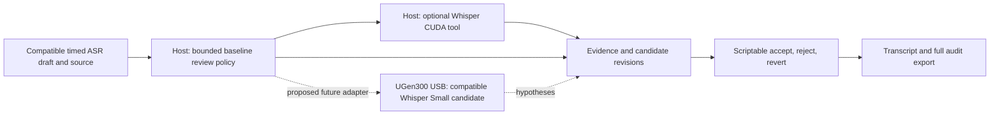

# Transcript Review Agent

A review and data-preparation layer downstream of compatible Whisper and task-specific ASR drafts.

ASR produces an initial transcript. Preparing usable transcript data still involves checking the source, correcting errors and organizing evidence. The intended system performs the first review pass and presents proposed changes for human confirmation. Medical research is the initial proposed validation setting; interviews and other research recordings are candidates requiring their own input and quality validation. The product does not diagnose or score clinical assessments.

## Intended workflow

1. Import source audio/video and an ASR draft. Preserve available timestamps and speaker metadata. Unsupported formats or missing alignment require an explicit adapter.
2. Inspect the full declared source timeline and transcript. Gaps, overlaps and coverage signals are cues, not proof of errors or omissions.
3. Select local tools and context, recording actions, evidence, failures and resource limits.
4. Present source-linked candidate revisions and unresolved items. Preserve the original, including repetition, negation, numbers and self-corrections.
5. Let the reviewer accept, reject or revert changes. Export a time-coded transcript, reversible decision history and unresolved work.

Pending text retains the original. Automatically checked and human confirmed are different states. An unflagged span may still contain errors.

## Current implementation and proposed architecture

The runnable prototype is a standard-library CLI with a **fixed baseline policy**, an explicitly fictional offline evidence tool, and an optional real local Transformers Whisper CUDA tool. It is not a completed LLM agent. The current host GPU probe uses Whisper medium because an existing checkpoint was available. It does not establish Whisper Small compatibility on USB.

Model-based action selection, a reviewer UI, broader audio/video conversion, missing-timestamp alignment and a USB adapter are not implemented. The local host must satisfy its model/runtime requirements. USB memory does not guarantee compatibility or make an arbitrary weak host sufficient.

## Evidence needed for the product claim

Compare A: existing ASR plus full manual review, B: a predefined checking policy, and C: an adaptive agent, using the same starting drafts and held-out recordings. B and C must use matched tools and budgets. A fixed policy may contain rule-based branches. Set the final-quality threshold, resource budgets and stopping rules before viewing the test set. Use a complete independent reference transcript and lawful public or consented staged material.

Measure active human minutes per source-audio hour to the same final quality, along with missed errors, incorrect changes, correct repairs, whole-utterance omissions and residual errors in unflagged text. Report negation and number errors separately. Separate natural ASR errors from injected errors and control repeated-listening memory effects. Record machine waiting and end-to-end duration independently because they may overlap with human effort.

No human-effort reduction, final-quality gain, cost saving or shorter end-to-end completion has been measured. A single synthetic GPU inference is engineering feasibility evidence only. See [validation](validation.md) and [prototype plan](prototype-plan.md).
